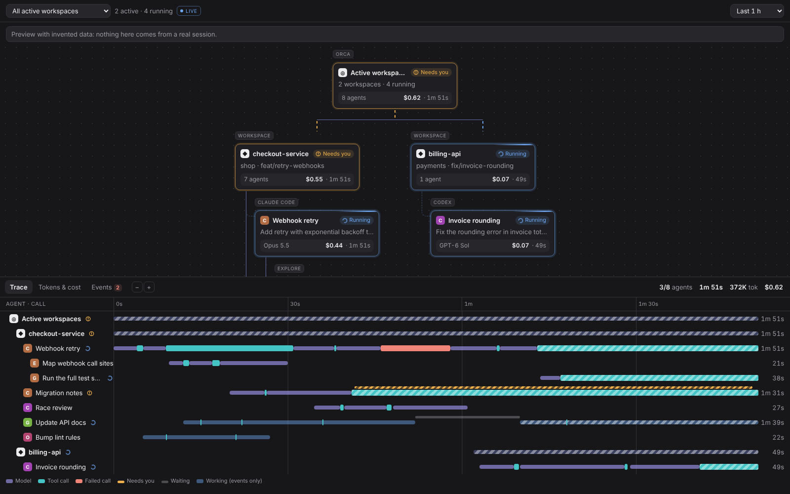
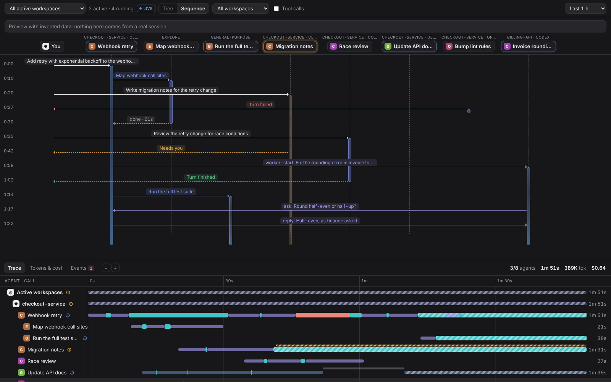

# Agent Trace

An [Orca](https://orca.dev) plugin: a live, animated run view of your agents.



*Screenshots use invented sample data.*

By default it shows **every active workspace** at once: Orca → workspaces → agents → subagents,
each card with its state, model, tokens, estimated cost and duration. Below the tree: a trace
timeline of model turns and tool calls, a tokens and cost table, and an event log. A workspace is
active while one of its agents is running or waiting on you, and for 15 minutes after its last
agent activity. The first selector switches to the focused workspace or to one workspace by name.

The **Sequence** view (top bar: Tree | Sequence) shows the interaction as a sequence diagram: one
lane per participant and one row per message, in order.



- **You → agent**: prompts. **Agent ⇢ you**: it needs you, or its turn finished, failed or stopped.
- **Agent → subagent** and back: the call that started it and its return. Subagents that ran at
  the same time are framed `PAR`.
- **Agent → agent**: Orca orchestration (`orca orchestration worker-start`, `dispatch`, `send`,
  `ask`, `reply`, ...), paired through the task, dispatch, message and terminal ids both sides
  carry, across workspaces. A message whose other side is not in view goes to an **Orca** lane.
- **Agent → tools** (optional, "Tool calls"): Shell, Files, Web, one lane per MCP server. A run
  of calls to one lane is one row; a failed call gets its own, and a failed call tried again is
  framed `RETRY`.

Click a lane to keep only that agent's session. In the all-workspaces scope, tool calls start
hidden so the agent-to-agent flow stands out, and a selector narrows to one workspace.

It is read-only (it never sends anything to an agent). Its only network use is an optional [Agent Trace hub](#remote-hosts-and-delivery-statistics) on your tailnet.

Motion: running cards breathe and carry a sweeping light, connectors into a running agent flow
(amber when it waits on you), running bars are striped and grow, and durations count up every
second between polls. `prefers-reduced-motion` turns it off.

It shows up in two places:

- **Right sidebar panel** "Agent Trace". Widen the sidebar for the tree layout; narrow, it is an
  indented list.
- **Editor tab**: tab bar **+** → **New Agent Trace view**. This creates an `untitled.agenttrace`
  file in the workspace folder and opens it in the plugin's editor (see Known limits).

## Status

Early: version 0.3, used on one machine so far. Expect rough edges, and please open an issue with
what you see.

## Install

Requires Orca **1.4.248 or later**, desktop app.

```sh
orca plugin install jalarrea2/orca-agent-trace
```

Or clone this repository and add the folder under Settings → Plugins → ⋯ → **Development
folders…**, then review and enable it.

Orca shows it as **Full access**: the worker is a Node program that reads transcript files on
your disk. Capabilities asked: `agent:read`, `workspace:read`, `storage:own`, `settings:own`.

## Where the data comes from

| Layer | Source | Agents | Gives |
| --- | --- | --- | --- |
| Status | `agent.status.changed` event, `agents.list` | Any agent Orca runs | Running / Needs you / Waiting / Done / Failed, time in each state |
| Tool calls | `agent.tool.after` hook (observe only) | Any agent that reports tool calls to Orca | Tool name, short label, when it finished |
| Transcripts | `~/.claude/projects`, `~/.codex/sessions` | Claude Code, Codex | Model turns, tool call durations and failures, tokens, estimated cost, Claude Code subagents |

An agent with no transcript adapter (Gemini, OpenCode, Cursor, ...) appears as an **Events only**
card: state, working time and tool ticks, but no tokens or cost.

Orca has no parent/child relation between agents in different terminals, so the sessions of a
workspace sit side by side under it.

## Settings

| Setting | Default | Meaning |
| --- | --- | --- |
| Default time range | Last 6 hours | How far back a one-workspace view looks when it opens (the all-workspaces view opens on the last hour) |
| Show tool call labels | On | Label calls with the file name, command start or web host; off keeps only the tool name |
| Claude Code folder | `~/.claude` | Folder that holds `projects/`. An absolute path, or one starting with `~`; anything else is ignored |
| Codex folder | `~/.codex` | Folder that holds `sessions/`. Same rule |

## Remote hosts and delivery statistics

Agents that Orca runs on another host (an Orca server) write their transcripts there, out of the
plugin's reach. An **Agent Trace hub** (`hub/server.mjs`, Node 22, no dependencies) on that host
serves them to the plugin, and adds two things:

- **OpenTelemetry**: an OTLP/HTTP JSON receiver for Claude Code and Codex. The cost an agent
  reports itself shows next to the estimate in **Tokens & cost** ("reported").
- **Delivery** tab: pull requests opened, merged and closed, contributors and lines merged over
  the last 24 hours and 7 days, and the four DORA metrics with their performance band, per
  project or for all of them. Lead time is pull request opened → merged; deploys are runs of the
  repository's `deploy*.yml` workflow on `main` (or CI pushes to `main` when there is none);
  change failure rate is failed / finished deploy runs; time to restore is a failed deploy run to
  the next successful one. Projects are the checkouts in the hub host's `~/projects`, read through
  its `gh` sign-in and refreshed every 5 minutes; `~/.config/agent-trace-hub/repos.json` overrides them.

Setup (orca-cloud has the scripts): `server/agent-trace-hub/install.sh` on the host as its Orca
user, `server/agent-trace-hub/tailscale-serve.sh` once with sudo to publish the API on the
tailnet, then `scripts/agent-trace-pair.sh` on your computer, which writes
`~/.config/agent-trace/hubs.json` (0600) without printing the token.

The **project** selector in the top bar narrows every view, the Delivery tab included, to one
Orca project (repository). Each workspace card and the totals show a progress bar: finished
agents (done, failed, stopped) first, then the ones still running, needing you or waiting.

## Security and privacy

- **Read-only.** The worker opens transcript files for reading and nothing else: it writes no
  files and starts no processes. Its only network requests go to the hubs in
  `~/.config/agent-trace/hubs.json`, which must be on your tailnet; without that file it makes none. The view frame has no
  network access (Orca denies it). There are no dependencies and no build step: what is in this
  repository is what runs.
- **What is stored.** Only Orca's own events, in the plugin's private storage (`storage:own`), so
  the timeline survives a worker restart: per terminal pane, its title, its state changes and the
  name and short label of each tool call, for 7 days. No prompt text, tool input or tool output is stored.
  Transcripts are read in place and never copied.
- **What is shown.** The start of each prompt, the start of each shell command, file names, web
  hosts and error messages. Before any of these is shown or stored, common secret shapes are
  masked as `***`: credentials in URLs, bearer tokens, well-known API key formats, and the values
  of flags or variables named like a password, token, secret or key. This is best effort, not a
  guarantee: a secret in an unusual form can still appear, so look before you share a screenshot.
  Turn **Show tool call labels** off to keep only tool names.
- **Untrusted text.** Transcripts hold whatever an agent read, including text written to mislead
  it. Every string is escaped before it reaches the page, names are cut to a fixed length, and a
  transcript line over 32 MiB is skipped. `tests/security.test.mjs` covers these cases.

To report a vulnerability, see [SECURITY.md](SECURITY.md).

## Known limits

- **Lightly tested.** In Orca it has drawn real Codex and Claude Code sessions across several
  workspaces. Subagents and events-only agents have only been run against the stand-in host in
  `tests/`.
- **Each "New Agent Trace view" creates a file.** Orca writes `untitled.agenttrace` into the
  workspace folder, where git sees it as untracked. Add `*.agenttrace` to your global gitignore
  so an agent's `git add -A` does not pick it up.
- **Agents of unfocused workspaces can land under "Other agents".** Before host API 1.7 an event
  names its workspace by a raw id that differs from the one `workspace.list` gives. The worker
  learns the pairing when you focus a workspace and also tries the worktree path; an agent it
  still cannot place is listed under "Other agents". Claude Code and Codex sessions are placed by
  their folder, so this only affects events-only agents and live state.
- **The all-workspaces view stats every Claude Code session file of every workspace on each
  poll** (every 3 s). With hundreds of worktrees, watch the worker's CPU.
- **Pane ↔ transcript matching is by time** on Orca ≤ 1.4.258, which does not report a session id
  on status events. Two sessions of the same agent that start within seconds of each other in one
  workspace can swap panes (state shown on the wrong card; tokens stay right).
- **Transcript formats are not a contract.** The Claude Code and Codex field names are listed at
  the top of each adapter; a new CLI version can change them.
- **Cost is an estimate** from `src/core/prices-data.mjs` (snapshot of 2026-11-12, Anthropic and
  OpenAI models), not a bill. A model missing from the table shows "no price"; totals then carry
  a `+`.
- **Tool calls of events-only agents are ticks**, not bars: Orca reports when a call finished,
  not when it started. Starting times would need the `agent.tool.before` hook, which makes Claude
  Code wait for the plugin on every call, so it is left out.
- **A prompt counts as yours unless it carries orchestration ids.** A session started by an Orca
  automation, or a hand-off without ids, shows as a prompt from You.
- **Agent pairing relies on the orchestration ids appearing in the transcripts**: in the
  coordinator's commands and their output, and in the worker's first prompt. It is tested
  against Orca's documented commands, not yet against a real orchestrated run.
- **Session titles are the first prompt.** For sessions started by an automation that is often
  boilerplate.
- **Local machine only.** Workspaces on SSH or paired hosts show state but no transcripts.
- No pause or stop controls.

## When host API 1.8 and 1.9 ship

They add a session id to status events and `agent.listSessions` (title and total tokens of every
agent's sessions, behind `history:read`). The matching code already prefers a session id when one
arrives. To get token totals for events-only agents, add `{ "kind": "history:read" }` to
`capabilities`, raise `engines.orca`, and fill `tokens` for unmatched panes in
`src/core/snapshot.mjs` from `agent.listSessions`.

## Layout

```
orca-plugin.json            manifest (format 2)
src/worker.mjs              the only file that knows Orca: events, hook, panel handler, storage
src/core/live.mjs           agent-agnostic store of Orca's events
src/core/adapters/*.mjs     transcript lines → normalized session (claude, codex)
src/core/snapshot.mjs       sessions + live panes → what the view draws
src/core/pricing.mjs        cost from the local price table
src/node/transcripts.mjs    finds each workspace's transcripts, reads only appended bytes
src/core/adapters/orch.mjs  orchestration commands and ids in shell calls
view/                       panel (index.html) and editor tab (editor.html), no framework
view/sequence.js            the sequence view: lanes, rows and frames from a snapshot
dev/preview.html            the view in a plain browser, over invented data
tests/                      node --test
```

## Add an agent

1. Write `src/core/adapters/<agent>.mjs` exporting a parser with `push(line)` and `result()`, where
   `result()` returns `{ agentKind, sessionId, cwd, title, agents, events }` in the shape
   `claude.mjs` returns (helpers in `adapters/shared.mjs`).
2. In `src/node/transcripts.mjs`, add how to find that agent's files for a workspace folder and
   call `readSession('<agent>', sessionId, files)`.
3. Add a fixture and a test in `tests/`.

## Develop

```sh
npm test                    # node --test: adapters, pricing, live store, snapshots, worker, security
npm run preview             # then open http://localhost:8765/dev/preview.html (?theme=dark)
orca plugin validate .      # manifest and file checks, as Orca runs them
orca plugin dev watch .     # load as local.agent-trace, reload on save, print logs
```

## Credits and license

MIT, see [LICENSE](LICENSE). The price table is derived from
[orca-usage-insights](https://github.com/Etherll/orca-usage-insights) (MIT); see
[NOTICE.md](NOTICE.md). Not affiliated with Orca or Stably.
